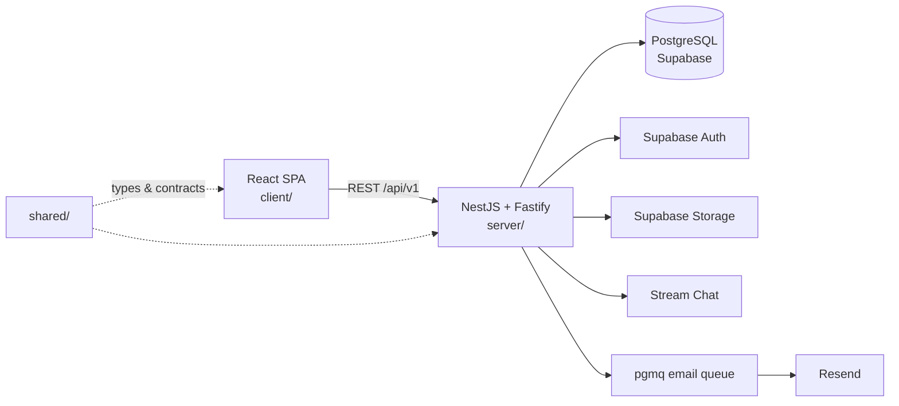

# Wasl · وصل

**A bilingual (Arabic/English, RTL-aware) community and event platform for Arabs in Türkiye.**

Wasl lets people discover public communities and events without an account, then join, register, organize and communicate after signing in. It covers the full journey — **discover → evaluate → join → admission → participate → manage → communicate** — with server-enforced capacity, waitlists, permissions, moderation and notifications.

[](https://nodejs.org)
[](https://pnpm.io)
[](https://www.typescriptlang.org)
[](https://react.dev)
[](https://nestjs.com)
[](https://supabase.com)

---

## Overview

- **Audience** — Arab university students first, plus professionals, families, organizers, associations and organizations across Türkiye. Not limited to one city.
- **Public by default** — visitors browse communities, events and organization profiles without signing in. Signing in is required only to act.
- **One identity, many roles** — a person has a single account and holds resource-scoped roles: organizer, community manager, organization owner/admin, platform admin.
- **Server is authoritative** — NestJS owns authorization, capacity and state transitions. The client never decides admission.

## Features

| Area          | What is implemented                                                                                                                                                          |
| ------------- | ---------------------------------------------------------------------------------------------------------------------------------------------------------------------------- |
| Discovery     | Home page, unified search with keyword, city, category and event-date filters, paginated results, URL-backed filter state, community/event/organization/user pages           |
| Accounts      | Supabase Auth with a stable Wasl identity, public profile vs. private account data, profile editing, photo uploads, password reset                                           |
| Creation      | Create, edit, archive and cancel communities and events; public or unlisted event visibility; capacity and admission configuration                                           |
| Participation | Join/leave and register/cancel, explicit status lifecycles with history, organizer accept/reject, attendance marking, transactional capacity limits, FIFO waitlist promotion |
| Organizations | Owner plus admins, single-use hashed invitations, ownership transfer, verification requests and platform-admin review                                                        |
| Discussions   | PostgreSQL-native community topics and event threads with one-level replies, edits, moderation and closing — not delegated to chat                                           |
| Messaging     | Stream-backed community and event chats plus direct messages, server-issued tokens, channel-scoped moderators, block/report, membership reconciliation worker                |
| Notifications | In-app records plus a durable email queue with idempotency and retry, delivered through Resend                                                                               |
| Moderation    | User reports, moderator queue, platform-admin console with TOTP MFA, audit references                                                                                        |
| Privacy       | 18+ gate, versioned legal acceptance records, `/privacy` data export, deletion requests with provider actions and retry, admin privacy queue, retention-policy slots         |
| Release       | Security headers, throttling, readiness health check, CI workflow, Render blueprint, `robots.txt` and a build-time sitemap                                                   |

Intentionally **out of scope** for the MVP: payments, ticketing and QR check-in, private communities, AI personalization, push notifications, ratings, enterprise analytics and monetization.

## Tech stack

| Layer        | Choice                                                                                                                                                |
| ------------ | ----------------------------------------------------------------------------------------------------------------------------------------------------- |
| Monorepo     | pnpm 10 workspaces on Node.js 24                                                                                                                      |
| Client       | React 19, TypeScript, Vite, React Router (Data Mode), TanStack Query, Tailwind CSS v4, shadcn/ui, React Hook Form, Zod, i18next (EN/AR + RTL), Unhead |
| Server       | NestJS 11 on the Fastify adapter, REST/JSON, class-validator DTOs, Zod-validated environment, OpenAPI, `@nestjs/terminus`, `@nestjs/throttler`        |
| Data         | PostgreSQL on Supabase, Drizzle ORM and Drizzle Kit SQL migrations                                                                                    |
| Integrations | Supabase Auth and Storage, Stream Chat, Resend                                                                                                        |
| Contracts    | NestJS OpenAPI → Orval-generated typed client and MSW mocks                                                                                           |
| Testing      | Vitest, React Testing Library, MSW, Playwright, Storybook                                                                                             |
| Delivery     | GitHub Actions, Render (web service + static site)                                                                                                    |

## Architecture

A **modular monolith**: one deployable NestJS API with modules that each own their data and expose narrow contracts. No microservices, Redis, Kafka or Kubernetes without a measured need.



- **Reads** — route → generated client → controller → service → PostgreSQL → React.
- **Writes** — the client sends its Supabase access token; the server verifies it, resolves the Wasl user, checks resource-scoped permission, then runs the action or transaction.
- **Authorization** — lives only on the server. Roles are resource-scoped and never trusted from the client.
- **Chat eligibility** — determined by Wasl, not by the provider; revocation is reconciled by a worker.

## Repository layout

```text
wasl/
├── client/                 React SPA
│   ├── src/app/            router, providers, layout
│   ├── src/features/       home, discovery, resources, auth, profile, creation,
│   │                       participation, organizations, discussions, messaging,
│   │                       notifications, moderation, privacy
│   ├── src/api/            Orval-generated client and MSW mocks
│   ├── src/styles/         design tokens and Tailwind theme
│   └── e2e/                Playwright guest journeys
├── server/                 NestJS API
│   ├── src/modules/        auth, users, communities, events, discovery,
│   │                       participation, organizations, discussions, messaging,
│   │                       notifications, moderation, privacy
│   ├── src/common/         HTTP concerns: health, filters, interceptors
│   ├── src/db/             Drizzle schema and client
│   ├── drizzle/            ordered SQL migrations
│   └── test/               unit and PostgreSQL integration tests
├── shared/                 cross-package contracts
├── docs/                   product, architecture, phases and handoffs
└── AGENTS.md               operating instructions for coding agents
```

## Getting started

### Requirements

- Node.js 24.19.0 (see `.node-version`)
- Corepack with pnpm 10.15.1
- A Supabase project for database-backed work

### Install and run

```sh
corepack pnpm install
corepack pnpm dev
```

The web app runs at `http://localhost:5173`; the API at `http://localhost:3000`. A database-free API start is supported so that health checks work before Supabase is configured.

### Configuration

Copy the committed templates and fill them in. Local `.env` files are git-ignored.

```sh
cp client/.env.example client/.env
cp server/.env.example server/.env
```

| File          | Variables                                                                                                                                                                                                                                                            |
| ------------- | -------------------------------------------------------------------------------------------------------------------------------------------------------------------------------------------------------------------------------------------------------------------- |
| `client/.env` | `VITE_API_URL` (optional; empty means same-origin `/api`), `VITE_SUPABASE_URL`, `VITE_SUPABASE_PUBLISHABLE_KEY`                                                                                                                                                      |
| `server/.env` | `NODE_ENV`, `PORT`, `CLIENT_ORIGIN`, `DATABASE_URL`, `SUPABASE_URL`, `SUPABASE_PUBLISHABLE_KEY`, `SUPABASE_SERVICE_ROLE_KEY`, `PLATFORM_ADMIN_USER_IDS`, `RESEND_API_KEY`, `RESEND_FROM_EMAIL`, `STREAM_API_KEY`, `STREAM_API_SECRET`, `STREAM_PERMISSIONS_VERIFIED` |

Only publishable values belong in the client. The database URL, service-role key, Stream secret and Resend key stay on the server. See [`docs/GETTING_STARTED.md`](docs/GETTING_STARTED.md) for production-mode environment handling.

### Database

```sh
corepack pnpm db:generate   # generate SQL from schema changes
corepack pnpm db:migrate    # apply migrations
corepack pnpm db:seed       # reference cities/categories + labelled sample data
```

Review generated SQL in `server/drizzle/` before applying it to a shared database. The seed refuses to run when `NODE_ENV=production`.

## Scripts

| Command                                 | Purpose                                              |
| --------------------------------------- | ---------------------------------------------------- |
| `corepack pnpm dev`                     | Run client and server in parallel                    |
| `corepack pnpm build`                   | Regenerate the API contract, then build all packages |
| `corepack pnpm typecheck`               | Strict TypeScript checks across the workspace        |
| `corepack pnpm lint`                    | ESLint with `--max-warnings=0`                       |
| `corepack pnpm format` / `format:check` | Prettier write / verify                              |
| `corepack pnpm test`                    | Unit tests for every package                         |
| `corepack pnpm test:e2e`                | Playwright guest journeys                            |
| `corepack pnpm api:generate`            | Regenerate OpenAPI and the Orval client              |
| `corepack pnpm test:*:postgres`         | Integration suites against a real database           |
| `corepack pnpm storybook:build`         | Build the component catalogue                        |

Generated API code is produced from the NestJS OpenAPI document; never edit it by hand.

## Deployment

`render.yaml` defines two services: `wasl-api` (NestJS) and `wasl-web` (static client). Secrets are marked `sync: false` and are entered in the Render dashboard, never committed. The API health check is `/api/v1/health/ready`, which returns `503` when PostgreSQL is unreachable.

Step-by-step instructions, including domain, Supabase, Resend and Stream setup, live in [`docs/production-handoff.md`](docs/production-handoff.md).

## Documentation

| Document                                                             | Contents                                                   |
| -------------------------------------------------------------------- | ---------------------------------------------------------- |
| [`docs/GETTING_STARTED.md`](docs/GETTING_STARTED.md)                 | Local setup, environment, database and quality commands    |
| [`docs/IMPLEMENTATION_GUIDE.md`](docs/IMPLEMENTATION_GUIDE.md)       | Product rules, permissions, phases and acceptance criteria |
| [`docs/context/01-PRODUCT.md`](docs/context/01-PRODUCT.md)           | Product scope and participation invariants                 |
| [`docs/context/02-ARCHITECTURE.md`](docs/context/02-ARCHITECTURE.md) | Module boundaries and ownership rules                      |
| [`docs/context/03-TECH-STACK.md`](docs/context/03-TECH-STACK.md)     | Approved technology baseline                               |
| [`docs/PROJECT_HANDOFF.md`](docs/PROJECT_HANDOFF.md)                 | Build history, verified state and known gaps               |
| [`docs/production-handoff.md`](docs/production-handoff.md)           | Launch runbook and smoke tests                             |
| [`docs/launch-decisions.md`](docs/launch-decisions.md)               | Legal, privacy and age decision register                   |
| [`docs/design/README.md`](docs/design/README.md)                     | Design token contract and theme notes                      |
| [`docs/phases/`](docs/phases)                                        | Per-phase implementation notes                             |

## Project status

All eight build phases are closed and the app runs end to end against a Supabase project. Remaining work is launch-related:

- Legal texts, controller identity, age-assurance method and retention periods are **pending owner/counsel approval**. Until published documents exist, `/privacy` lists nothing to accept while the 18+ self-declaration gate stays enforced.
- Irreversible retention erasure is disabled until those periods are approved.
- End-to-end tests cover guest journeys only; there are no automated signed-in journeys through the real API.
- `format:check` is not yet part of CI because the existing tree is not fully formatted.

## Principles

- Business rules and authorization are enforced by the server, never by the UI.
- Capacity and waitlist decisions run inside PostgreSQL transactions to prevent overbooking.
- Modules own their data; cross-module calls go through narrow contracts.
- Personal data is minimized, private media stays private, and secrets never reach source control.
